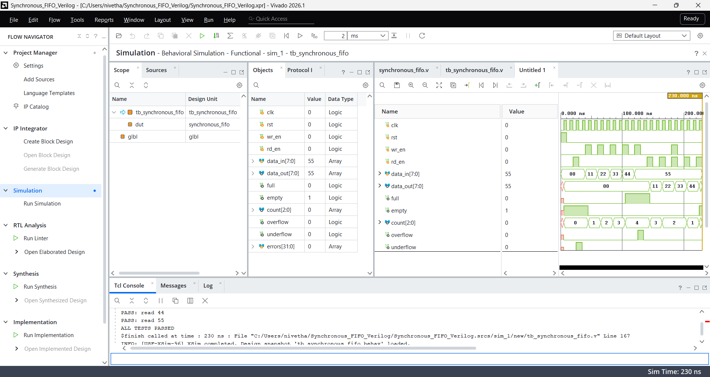

# Synchronous FIFO Design in Verilog

## Description
A synchronous FIFO (First In, First Out) implemented in Verilog HDL and verified using a self-checking testbench in Vivado.

## Features
- 8-bit data width
- 4 memory locations
- Synchronous reset
- Read and write pointer management
- Full and empty flag generation
- Overflow and underflow protection
- Simultaneous read and write support
- Self-checking testbench

## Files
- `synchronous_fifo.v` - FIFO design
- `tb_synchronous_fifo.v` - Testbench

## Simulation Results
- FIFO read/write order verified
- Full and empty conditions verified
- Overflow and underflow protection verified
- Simultaneous read/write operation verified
- All testbench checks passed in Vivado 2026.1

## Simulation Waveform

## Tools Used
- Verilog HDL
- AMD Xilinx Vivado 2026.1
